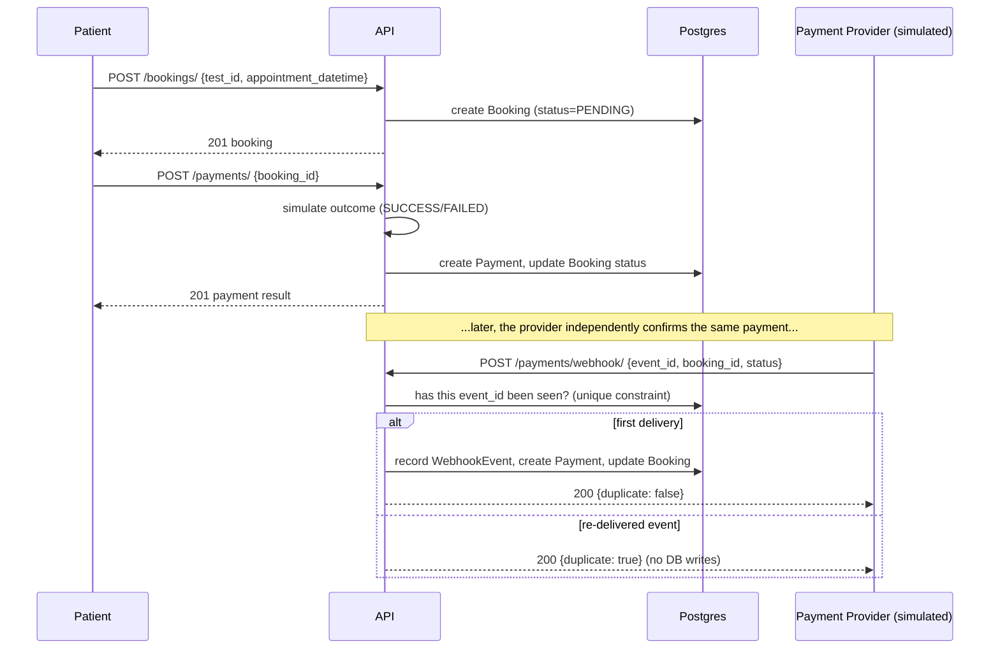

# EVE Healthcare — Diagnostic Booking API

[](https://github.com/priyansh-0304/eve-healthcare/actions/workflows/tests.yml)

A backend service for browsing diagnostic centres/tests, booking a test, and paying for it
through a simulated payment flow with an idempotent webhook.

**Stack:** FastAPI, SQLAlchemy (ORM), PostgreSQL, Alembic (migrations), Redis (optional
read-through cache), JWT auth (python-jose), Pydantic v2.

---

## 1. Running it locally

### Option A — Docker (recommended, matches production topology)

```bash
docker compose up --build
```

This starts Postgres, Redis, and the API together. On boot the API container runs
`alembic upgrade head` (applying the schema) before starting the server — see
[Database migrations](#4-database-migrations-alembic). Once it's up:

- API: http://localhost:8000
- Interactive docs (Swagger UI): http://localhost:8000/docs
- Health check: http://localhost:8000/health

Default webhook secret in Docker is `CHANGE_ME_WEBHOOK_SECRET` (override via a `.env` file
next to `docker-compose.yml`, or `SECRET_KEY=... WEBHOOK_SECRET=... docker compose up --build`).

### Option B — Local Python + local/remote Postgres

```bash
python -m venv venv
source venv/bin/activate        # venv\Scripts\activate on Windows
pip install -r requirements.txt

cp .env.example .env            # then edit DATABASE_URL etc. as needed
alembic upgrade head            # apply the schema — see section 4
uvicorn app.main:app --reload
```

Redis is optional outside Docker too — if `REDIS_URL` isn't reachable, the app logs a
warning once and runs with caching disabled; nothing breaks.

### Running the tests

Tests run against an isolated SQLite database and don't need Postgres, Docker, or Redis:

```bash
pip install -r requirements.txt
pytest -v
```

30 tests cover auth, RBAC on centre/test management, booking edge cases (past dates,
double-booking payment, ownership checks), payment/webhook behaviour — including webhook
idempotency under repeated delivery and a race-condition guard — and cache-invalidation
correctness (the suite passes identically whether or not Redis happens to be running).

A GitHub Actions workflow (`.github/workflows/tests.yml`) runs this same suite, with a real
Redis service, on every push and pull request.

---

## 2. API reference

All request/response bodies are JSON. Full interactive reference (with example payloads,
try-it-out) is at `/docs` once the server is running — the summary below is enough to get
started from the CLI.

### Auth

| Method | Path | Auth | Notes |
|---|---|---|---|
| POST | `/auth/signup` | – | `{email, password, full_name, is_admin?}` → returns a JWT. `is_admin` is a demo convenience — see Assumptions. |
| POST | `/auth/login` | – | Form-encoded (`username`, `password`) per OAuth2 password flow → returns a JWT. |

```bash
curl -X POST localhost:8000/auth/signup -H "Content-Type: application/json" \
  -d '{"email":"patient@example.com","password":"password123","full_name":"Asha Patel"}'

curl -X POST localhost:8000/auth/login \
  -d "username=patient@example.com&password=password123"
```

Use the returned `access_token` as `Authorization: Bearer <token>` on every endpoint below
marked "auth required".

### Diagnostic centres & tests

| Method | Path | Auth | Notes |
|---|---|---|---|
| POST | `/centres/` | admin | `{name, location}` |
| GET | `/centres/` | – | List centres (each with nested `tests`); optional `?location=` filter, pagination via `skip`/`limit`. The default (unfiltered, first page) response is cached in Redis for `CACHE_TTL_SECONDS` (default 30s) and invalidated immediately on any centre/test write. |
| GET | `/centres/{id}` | – | Single centre with its tests |
| POST | `/centres/{id}/tests/` | admin | `{name, price}` — adds a test to that centre |
| GET | `/tests/` | – | List tests, optional `?centre_id=` filter — same caching behaviour as above |
| GET | `/tests/{id}` | – | Single test |

### Bookings (all require auth)

| Method | Path | Notes |
|---|---|---|
| POST | `/bookings/` | `{test_id, appointment_datetime}`. Amount/centre are derived server-side from the test, not client-supplied. Rejects past appointment times. |
| GET | `/bookings/` | Lists the current user's own bookings |
| GET | `/bookings/{id}` | 403 if you don't own it (and aren't admin) |
| PATCH | `/bookings/{id}/cancel` | Only from `PENDING`/`CONFIRMED`; 400 otherwise |

```bash
curl -X POST localhost:8000/bookings/ -H "Authorization: Bearer $TOKEN" \
  -H "Content-Type: application/json" \
  -d '{"test_id":"<test-id>","appointment_datetime":"2026-10-05T10:00:00Z"}'
```

### Payments

| Method | Path | Auth | Notes |
|---|---|---|---|
| POST | `/payments/` | user (booking owner) | `{booking_id}` — synchronously simulates a provider decision (`SUCCESS`/`FAILED`, weighted by `PAYMENT_SUCCESS_RATE`), updates the booking to `CONFIRMED`/`FAILED`. Rate-limited (10/min/IP). |
| POST | `/payments/webhook/` | shared secret (`X-Webhook-Secret` header) | `{event_id, booking_id, status}` — simulates an async provider callback. **Idempotent**: re-delivering the same `event_id` is a no-op the second time onward. Rate-limited (30/min/IP). |

```bash
curl -X POST localhost:8000/payments/ -H "Authorization: Bearer $TOKEN" \
  -H "Content-Type: application/json" -d '{"booking_id":"<booking-id>"}'

curl -X POST localhost:8000/payments/webhook/ \
  -H "X-Webhook-Secret: $WEBHOOK_SECRET" -H "Content-Type: application/json" \
  -d '{"event_id":"evt_123","booking_id":"<booking-id>","status":"SUCCESS"}'
```

### Booking + payment flow



Booking status flow:

```
PENDING --(payment SUCCESS)--> CONFIRMED
PENDING --(payment FAILED)---> FAILED
FAILED  --(retry payment)----> CONFIRMED | FAILED
PENDING/CONFIRMED --(cancel)-> CANCELLED   (terminal — a late webhook cannot reopen it)
```

---

## 3. Database / schema design

```
users(id, email UNIQUE, hashed_password, full_name, is_admin, created_at)
diagnostic_centres(id, name, location, created_at)
diagnostic_tests(id, centre_id → centres, name, price, created_at)
bookings(id, user_id → users, test_id → tests, centre_id → centres,
         appointment_datetime, amount, status ENUM, created_at, updated_at)
payments(id, booking_id → bookings, amount, status ENUM, created_at)
webhook_events(id, event_id UNIQUE, booking_id → bookings, payload_status, received_at)
```

Notes on the design:

- **`amount` and `centre_id` are copied onto the booking at creation time** rather than
  always joined from the test. If a centre later changes a test's price, existing bookings
  keep the price the patient actually agreed to.
- **A booking can have multiple `Payment` rows** (one per attempt/webhook event) rather than
  a single mutable payment field on the booking. This preserves a full audit trail —
  useful for support/dispute resolution — while `bookings.status` remains the single
  source of truth for "what state is this booking in right now."
- **`webhook_events` is the idempotency mechanism.** `event_id` has a unique constraint;
  `POST /payments/webhook/` checks for an existing row first (fast path) and also relies on
  the DB-level unique constraint (catching `IntegrityError`) as the real guarantee under
  concurrent duplicate deliveries — see `app/services/payment_service.py`.
- IDs are UUID strings rather than auto-increment integers, so booking/payment IDs aren't
  guessable/enumerable.

---

## 4. Database migrations (Alembic)

Schema is version-controlled with Alembic rather than inferred from model state at
startup. `alembic/versions/` holds one migration: `initial schema`, generated directly from
`app/models.py`'s `Base.metadata` — there's a single source of truth for the schema, not a
model file and a hand-maintained SQL file that can drift apart.

```bash
alembic upgrade head              # apply all pending migrations
alembic current                   # show the currently applied revision
alembic downgrade -1              # roll back one migration
alembic revision --autogenerate -m "describe your change"   # after editing app/models.py
```

Docker and the Dockerfile's default `CMD` both run `alembic upgrade head` automatically
before starting the server, so this is normally invisible — it only matters if you're
running Option B (local Python) or writing a new migration yourself.

---

## 5. Caching (Redis)

`GET /centres/` and `GET /tests/`, when called with no filters and default pagination (the
"browse everything" hot path), are cached in Redis for `CACHE_TTL_SECONDS` (default 30s,
see `.env.example`). Any admin write (`POST /centres/`, `POST /centres/{id}/tests/`)
immediately invalidates both cache keys, so a client is never shown stale data right after
a create — this is enforced by
`tests/test_centres.py::test_new_centre_and_test_appear_immediately_after_creation`, which
passes identically whether or not Redis is running.

Caching is entirely optional at runtime: `app/cache.py` wraps every Redis call in a
try/except, and after one failed connection attempt it stops retrying for the rest of the
process and simply serves every request straight from Postgres. There is no code path where
a Redis outage turns into an API error.

---

## 6. Project structure

```
app/
  main.py              FastAPI app, logging middleware, rate-limit handler, router wiring
  config.py            Settings (env-driven)
  database.py          Engine/session/Base
  models.py            SQLAlchemy models + enums (single source of truth for Alembic too)
  schemas.py           Pydantic request/response models
  auth.py              Password hashing, JWT encode/decode
  deps.py              get_current_user / get_current_admin dependencies
  cache.py             Redis read-through cache helpers, fails open if Redis is unreachable
  routers/             auth, centres, bookings, payments — one file per resource
  services/
    payment_service.py Payment simulation + idempotent webhook processing (kept out of
                        the router layer so it's unit-testable without spinning up HTTP)
alembic/                Migration environment + versions/ (schema history)
tests/                  pytest suite (SQLite-backed, isolated per test — DB and cache both
                        reset between tests, see tests/conftest.py)
.github/workflows/      CI: runs the test suite (with a Redis service) on every push/PR
```

---

## 7. Assumptions & design decisions

- **Admin role via `is_admin` on signup.** The assignment doesn't specify how centre/test
  management is authorized. Rather than leave it fully open, I added a `is_admin` flag that
  can be set at signup — good enough to demonstrate RBAC for this exercise. A real system
  would gate admin creation behind an invite/approval step, not self-service signup.
- **Payment simulation is synchronous.** `POST /payments/` immediately returns
  `SUCCESS`/`FAILED` rather than `PENDING` + async callback, since the assignment describes
  it as a mock endpoint. The webhook endpoint still exists and is fully idempotent, modeling
  the case where a provider *does* call back later (or retries).
- **Webhook auth is a shared-secret header**, not HMAC payload signing. A real provider
  (Stripe, Razorpay, etc.) signs the payload; a static shared secret is a reasonable stand-in
  for a fully mocked provider and keeps the example simple.
- **Only two list endpoints are cached**, and only their default (unfiltered, first-page)
  query shape. Caching every possible filter/pagination combination would need a much more
  elaborate key scheme for comparatively little benefit in an assignment of this scope.
- **Booking cancellation** is allowed from `PENDING` or `CONFIRMED`; a `CANCELLED` booking
  is terminal, and the webhook handler explicitly will not move a cancelled booking back to
  `CONFIRMED`/`FAILED` even if a stale success event arrives after the cancellation.
- **No refund flow.** Cancelling a `CONFIRMED` (already-paid) booking doesn't simulate a
  refund — out of scope for "simulated payments," but noted as a gap below.

## 8. What I'd improve with more time

- **Refund handling** when cancelling a paid booking, plus a `REFUNDED` status.
- **HMAC-signed webhooks** (timestamp + signature header) instead of a static shared secret,
  to also guard against replay of old-but-valid events.
- **Async DB access** (SQLAlchemy async + asyncpg) — kept sync here for simplicity and
  because the assignment's scope doesn't need the extra throughput, but it's the natural
  next step under real load.
- **Structured JSON logs** (e.g. via `structlog`) instead of formatted text lines, for easier
  log aggregation.
- **More granular rate limiting** (per-user, not just per-IP) and Redis-backed limiter state
  so limits hold across multiple API instances instead of resetting per-process (the same
  Redis instance used for caching could back this).
- **Pagination metadata** (`total`, `next`/`prev`) on list endpoints instead of plain arrays.
- **Cache more query shapes** (filtered/paginated listings), if usage data showed it was
  worth the added key-invalidation complexity.
